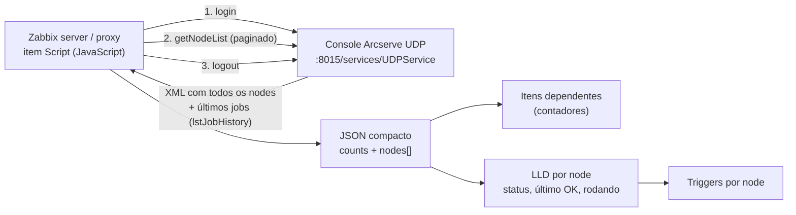

# Arcserve UDP by SOAP: template Zabbix


Template Zabbix que monitora os **jobs de backup do Arcserve UDP** direto pela API SOAP do console (`UDPService`). Não precisa de script no Windows, de `system.run` nem de `New-WebServiceProxy`.

A coleta inteira é **1 chamada à API** (`getNodeList`), que já traz o status do último backup e os últimos jobs de **todos os nodes**. O template cria um item por node, alerta falhas e backups atrasados, e fecha os alertas sozinho quando o backup volta a funcionar.

---

## Por que este template

A forma mais comum de monitorar o Arcserve UDP no Zabbix é um script PowerShell que usa `New-WebServiceProxy` e consulta o histórico de cada node. Esse modelo tem custos que pesam:

| | Script PowerShell tradicional | Este template |
|---|---|---|
| Chamadas à API por coleta | 1 + **N** (uma por node, histórico completo) | **1** `getNodeList` (mais login e logout) |
| Tempo de coleta (~120 nodes) | ~3 min + compilação do WSDL (~400 KB) a cada execução | **~11 s** |
| Onde roda | PowerShell no Windows (`system.run`) | Zabbix server/proxy (item **Script**) |
| Descoberta | 1 item por **JobID**, cresce sem parar | 1 item por **node**, fixo |
| Falha de job longo | Perdida se o filtro for por janela de início | Detectada: usa o **último job terminado** |
| Fechamento do alerta | Manual | **Automático** no próximo job OK |
| Sessão na API | Costuma ficar aberta | `logout` no final de toda coleta |

---

## Como funciona



1. O item mestre **`arcserveudp.get`** (tipo *Script*) roda no Zabbix server ou proxy. Ele faz login, lê a lista de nodes paginada e faz logout.
2. O XML é convertido em um JSON pequeno (cerca de 20 KB para 120 nodes) com os contadores gerais e um resumo por node.
3. Os **itens dependentes** e a **descoberta (LLD)** saem desse JSON, sem nenhuma chamada extra à API.

---

## Requisitos

- **Zabbix 7.0** ou superior (server ou proxy).
- O **server ou proxy** que monitora o host precisa alcançar o console do Arcserve UDP em **TCP 8015** (HTTPS).
- Um **usuário do Arcserve UDP** com acesso de leitura ao console (conta de domínio ou local).
- Teste a conectividade **a partir do proxy** antes de importar (veja [Validação antes de importar](#validação-antes-de-importar)).

---

## Instalação

1. **Importe o template:** *Data collection → Templates → Import* → `zbx_arcserver_udp_soap_template.yaml`.
2. **Crie ou escolha o host** que representa o console do Arcserve UDP e vincule o template **Arcserve UDP by SOAP**. O item é do tipo Script, então o host **não precisa de interface**. Se o host for monitorado por proxy, é o proxy que fará as chamadas à API.
3. **Preencha as macros obrigatórias no host:**

   | Macro | Exemplo |
   |---|---|
   | `{$ARCSERVEUDP.HOST}` | `udp-console.empresa.local` ou o IP |
   | `{$ARCSERVEUDP_USER}` | `svc_zabbix_udp` |
   | `{$ARCSERVEUDP_PASS}` | *(macro secreta)* |
   | `{$ARCSERVEUDP_DOMAIN}` | `EMPRESA` (vazio para conta local) |

4. **Teste o item** `Arcserve UDP: Get nodes and last jobs (SOAP)` com o botão **Test** no host. Ele deve devolver um JSON com `counts.nodes` maior que 0.
5. Aguarde a primeira coleta (`{$ARCSERVEUDP.INTERVAL}`, 10 min por padrão) para a descoberta criar os itens por node.

> **Dica:** se você usava um template baseado em PowerShell, desative-o no host para não receber alertas em dobro.

---

## O que é coletado

### Itens gerais

| Item | Chave |
|---|---|
| Get nodes and last jobs (SOAP), item mestre | `arcserveudp.get` |
| Nodes total | `arcserveudp.count.nodes` |
| Nodes with job running | `arcserveudp.count.running` |
| Nodes with last job OK | `arcserveudp.count.last_ok` |
| Nodes with last job failed | `arcserveudp.count.last_failed` |
| Nodes without backup | `arcserveudp.count.never` |
| Jobs (total / failed / finished / incomplete / canceled / missed) nas últimas `{$ARCSERVEUDP.COUNT.HOURS}` h | `arcserveudp.count.jobs_*` |

### Por node (descoberta `arcserveudp.node.discovery`)

| Protótipo | Chave | Descrição |
|---|---|---|
| last job status | `arcserveudp.node.status[{#NODEID}]` | Status do **último job terminado** (jobs em andamento são ignorados). `NoBackup` quando o node nunca teve backup. |
| last job ID | `arcserveudp.node.jobid[{#NODEID}]` | JobID desse job |
| last job start | `arcserveudp.node.start[{#NODEID}]` | Início do job (unixtime) |
| last OK backup | `arcserveudp.node.lastok[{#NODEID}]` | Início do último job com status em `{$ARCSERVEUDP.STATUS.OK}` |
| job running | `arcserveudp.node.running[{#NODEID}]` | 1 quando há job rodando agora |

Os itens recebem as tags `Node` e `Plan`. Nodes que somem do Arcserve são desativados após 1 dia e removidos após 7 dias.

---

## Alertas

| Trigger | Severidade | Dispara quando | Fecha quando |
|---|---|---|---|
| **Backup falhou** - Node `{#NODENAME}` Plano `{#PLANNAME}` | Average | O último job terminado tem status em `{$ARCSERVEUDP.STATUS.FAILED}` (Failed, Crash, LicenseFailed, BackupJob_PROC_EXIT) | O próximo job do node termina sem falha |
| **Backup com alerta** - Node `{#NODENAME}` Plano `{#PLANNAME}` | Warning | Último job em `{$ARCSERVEUDP.STATUS.WARN}` (Incomplete, Canceled, Missed) | No próximo job concluído |
| **Sem backup OK há mais de `{$ARCSERVEUDP.MAX.AGE}`** - Node `{#NODENAME}` | Warning | Nenhum job OK dentro de 26 h. Fica suprimido enquanto há job rodando ou enquanto o alerta de falha está ativo | Quando houver um backup OK |
| **API SOAP sem retorno há `{$ARCSERVEUDP.NODATA}`** | Average | A coleta parou (credencial, rede, certificado ou fault da API) | Quando a coleta volta |

Os alertas por node mostram nos dados operacionais o status, o JobID e o horário do job. Eles levam as tags `ApplId`, `Expire`, `InstanceID` (plano) e `ResourceId` (node), prontas para integração com ferramentas de ITSM.

> ⚠️ **Primeira coleta:** é comum haver vários nodes com último job **Incomplete**, e cada um vira um alerta Warning. Se para o seu ambiente Incomplete for aceitável, remova esse status de `{$ARCSERVEUDP.STATUS.WARN}`.

---

## Macros

| Macro | Padrão | Descrição |
|---|---|---|
| `{$ARCSERVEUDP.HOST}` | `<ARCSERVE_UDP_CONSOLE_IP_OR_FQDN>` | **Obrigatória.** IP ou FQDN do console |
| `{$ARCSERVEUDP.PORT}` | `8015` | Porta HTTPS do `UDPService` |
| `{$ARCSERVEUDP_USER}` | `<USERNAME>` | **Obrigatória.** Usuário do Arcserve UDP |
| `{$ARCSERVEUDP_PASS}` | `<PASSWORD>` | **Obrigatória.** Senha (macro secreta) |
| `{$ARCSERVEUDP_DOMAIN}` | `<AD_DOMAIN>` | Domínio do usuário (vazio para conta local) |
| `{$ARCSERVEUDP.INTERVAL}` | `10m` | Intervalo de coleta |
| `{$ARCSERVEUDP.TIMEOUT}` | `90s` | Timeout do item Script |
| `{$ARCSERVEUDP.PAGE.SIZE}` | `200` | Nodes por página do `getNodeList` |
| `{$ARCSERVEUDP.COUNT.HOURS}` | `24` | Janela (h) dos contadores de jobs |
| `{$ARCSERVEUDP.MAX.AGE}` | `26h` | Idade máxima do último backup OK |
| `{$ARCSERVEUDP.NODATA}` | `40m` | Tempo sem coleta para alertar a API |
| `{$ARCSERVEUDP.STATUS.FAILED}` | `^(Failed\|Crash\|LicenseFailed\|BackupJob_PROC_EXIT)$` | Status tratados como falha |
| `{$ARCSERVEUDP.STATUS.WARN}` | `^(Incomplete\|Canceled\|Missed)$` | Status tratados como alerta |
| `{$ARCSERVEUDP.STATUS.OK}` | `^(Finished\|Incomplete)$` | Status que contam como backup OK |
| `{$ARCSERVEUDP.NODE.MATCHES}` | `.*` | Regex de nodes a descobrir |
| `{$ARCSERVEUDP.NODE.NOT_MATCHES}` | `CHANGE_IF_NEEDED` | Regex de nodes a ignorar |
| `{$ARCSERVEUDP.PLAN.MATCHES}` | `.+` | Regex do plano (`.+` ignora nodes sem plano; `.*` inclui todos) |
| `{$ARCSERVEUDP.DATES.ARE.UTC}` | `1` | Tratamento das datas da API (veja abaixo) |

---

## Particularidades da API do Arcserve UDP

Comportamentos observados na API, que o template já contorna:

<details>
<summary><b>O cookie de sessão vem com <code>Path=/management</code></b></summary>

O `login` devolve `Set-Cookie: EDGEJSESSIONID=...; Path=/management`, mas o serviço fica em `/services/UDPService`. Clientes HTTP que seguem a regra de cookies (curl, navegadores) **não reenviam** a sessão, e a chamada seguinte falha com `Not login` (`EDGE-10000000C`). O template reenvia o cookie manualmente no cabeçalho `Cookie`.
</details>

<details>
<summary><b>Datas "UTC" chegam com o fuso do servidor colado</b></summary>

`jobUTCStartDate` traz os dígitos em UTC, mas com o offset do servidor no final. Por exemplo, `2026-11-19T08:04:14-03:00` significa 08:04 **UTC**, não 08:04 em -03:00. Ler a data como está deslocaria todos os cálculos de idade pelo tamanho do fuso. Com `{$ARCSERVEUDP.DATES.ARE.UTC}=1`, o template usa só os dígitos, como UTC. Se o seu console já mandar o offset correto, use `0`.
</details>

<details>
<summary><b><code>getNodeList</code> paginado exige <code>orderCol</code> e <code>orderType</code></b></summary>

Mandar `pagingConfig` sem esses dois campos causa `NullPointerException` no servidor (`EDGE-100000001`). O template sempre envia `orderCol=hostname` e `orderType=ASC`.
</details>

<details>
<summary><b>A paginação de <code>getJobHistoryList</code> é ignorada</b></summary>

`count` e `startIndex` não reduzem a resposta, e um `filter` preenchido tende a devolver 0 registros. Por isso o template **não** chama o histórico por node: usa o `lstJobHistory` que já vem embutido em cada node do `getNodeList`.
</details>

<details>
<summary><b>O <code>jobStatus</code> é um enum, não um número</b></summary>

Na ordem do WSDL: `All=0, Active=1, Finished=2, Canceled=3, Failed=4, Incomplete=5, Idle=6, Waiting=7, Crash=8, LicenseFailed=9, ...`. Scripts que comparam o status com números (por exemplo `-in 4,6,9`) costumam confundir **Idle (6)** com Crash e deixar passar o **Crash (8)**. O template trabalha com os nomes dos status.
</details>

---

## Validação antes de importar

Rode a partir do **server ou proxy** que vai monitorar o host:

```bash
read -s -p "Senha: " P; echo
U=https://<ARCSERVE_UDP_CONSOLE>:8015/services/UDPService
ENV='<soapenv:Envelope xmlns:soapenv="http://schemas.xmlsoap.org/soap/envelope/" xmlns:ws="http://webservice.edge.arcserve.ca.com/"><soapenv:Body>'
END='</soapenv:Body></soapenv:Envelope>'
H=(-sk -H 'Content-Type: text/xml' -H 'SOAPAction: ""')

# 1) login e captura do cookie de sessão
SID=$(curl "${H[@]}" -D - -o /dev/null "$U" \
  -d "${ENV}<ws:login><username>USUARIO</username><password>${P}</password><domain>DOMINIO</domain></ws:login>${END}" \
  | grep -io 'EDGEJSESSIONID=[^;]*'); echo "$SID"

# 2) 5 nodes (deve voltar <data>...</data> com d2dLastBackupJobStatus e lstJobHistory)
time curl "${H[@]}" -H "Cookie: $SID" "$U" \
  -d "${ENV}<ws:getNodeList><pagingConfig><orderCol>hostname</orderCol><orderType>ASC</orderType><pagesize>5</pagesize><startpos>0</startpos></pagingConfig></ws:getNodeList>${END}" | head -c 2000; echo

# 3) logout
curl "${H[@]}" -o /dev/null -H "Cookie: $SID" "$U" -d "${ENV}<ws:logout/>${END}"
```

---

## Troubleshooting

| Sintoma | Causa provável | O que fazer |
|---|---|---|
| Item mestre: `login failed: HTTP 500 - ...` | Usuário, senha ou domínio incorretos | Revise as macros `{$ARCSERVEUDP_USER}`, `_PASS` e `_DOMAIN` |
| `Not login` | O cookie de sessão não foi reenviado | Já tratado pelo template; em testes manuais, envie o `Cookie` explicitamente |
| `NullPointerException` | `getNodeList` sem `orderCol`/`orderType` | Já tratado pelo template |
| Timeout no item mestre | Muitos nodes ou console lento | Aumente `{$ARCSERVEUDP.TIMEOUT}` (máximo de 10 min) |
| Erro de conexão ou TLS | Firewall ou certificado | Teste `curl -k` a partir do proxy; se necessário, importe o certificado do console no trust store do proxy |
| Horários deslocados em algumas horas | Tratamento do fuso das datas | Ajuste `{$ARCSERVEUDP.DATES.ARE.UTC}` |
| Muitos alertas de *Backup com alerta* | Nodes com Incomplete recorrente | Remova `Incomplete` de `{$ARCSERVEUDP.STATUS.WARN}` |
| Node sem itens | Node sem plano, ou fora dos filtros | Ajuste `{$ARCSERVEUDP.PLAN.MATCHES}` e as macros `NODE.*` |

---

## Limitações conhecidas

- **O "último backup OK" vem do histórico embutido no node**, que tem cerca de 5 jobs. Se todos os jobs dentro dele falharam, `last OK backup` fica em 0 e o alerta de idade dispara. Esse é o comportamento esperado, porque não há sucesso recente.
- **Contadores de jobs por janela** consideram apenas esse histórico embutido. Em nodes com muitos jobs por dia, use-os como tendência, não como contagem exata.
- **O item `Days until user ... expires`** (`get.domain.user.pwd.exp.days[...]`) depende de um **UserParameter personalizado** no agente. Ele não faz parte da API do Arcserve. Se o seu ambiente não tiver esse UserParameter, desative ou remova o item.
- **Testado com o Arcserve UDP R6.5** (versão informada pela API). Outras versões podem ter variações no WSDL.

---

## Estrutura

```
.
├── zbx_arcserver_udp_soap_template.yaml   # template Zabbix 7.0
└── README.md
```

---

## Contribuições

Issues e pull requests são bem-vindos, principalmente com:
- comportamento da API em outras versões do Arcserve UDP;
- novos status de job ou de node;
- ajustes de layout e tags para integrações de ITSM.
